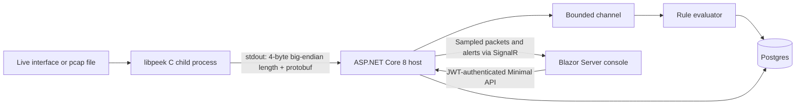

# PacketPeek

Status: in development



PacketPeek captures Ethernet/IP TCP and UDP traffic, tracks directional flows, and evaluates structured sliding-window rules. The console has three pages: `/flows`, `/rules`, and `/alerts`. Swagger is at `/swagger`.

## Run locally

Requires Docker Compose. From Bash, generate local credentials and start Postgres plus the app:

```sh
export POSTGRES_PASSWORD="$(python3 -c 'import secrets; print(secrets.token_hex(20))')"
export JWT_KEY="$(python3 -c 'import secrets; print(secrets.token_hex(32))')"
export OPERATOR_PASSWORD="Local-$(python3 -c 'import secrets; print(secrets.token_hex(16))')!"
export OPERATOR_USERNAME=operator
docker compose up --build -d
```

Open `http://localhost:8080/flows` and sign in using `OPERATOR_USERNAME` and the generated `OPERATOR_PASSWORD` from your shell. Preserve these environment values for subsequent Compose commands. The app applies committed migrations and creates the operator on first startup; an existing operator's password is not reset on later startups. Keep the JWT key stable while tokens are in use. Data persists in the named Postgres volume.

Capture is initially disabled so you can create a rule first. For example: metric `packets`, window `10`, grouping `src_ip`, threshold `1`, active. Replay the bundled synthetic fixture:

```sh
export ENGINE_ENABLED=true
docker compose up -d --no-deps --force-recreate app
```

This replays `/app/fixtures/http.pcap` via libpeek's `--pcap` flag. A fresh database with that single rule produces one alert and two closed flows. Repeating replay adds new database rows. `docker compose down` stops the stack while preserving data. For live capture, run libpeek with `--interface NAME`; it needs capture privileges on that interface. The supplied Compose configuration is for file replay.

## Build and test

Linux native dependencies: a C11 compiler, CMake, Make, pkg-config, Criterion, libpcap, protobuf-c, `protoc`, and Python with the protobuf module. On Ubuntu:

```sh
sudo apt-get update
sudo apt-get install -y build-essential cmake pkg-config libcriterion-dev libpcap-dev libprotobuf-c-dev protobuf-compiler python3-protobuf
make c-test
dotnet test dotnet/PacketPeek.sln
bash tests/e2e/run.sh
```

Use .NET SDK 8. The integration tests use Testcontainers and require Docker. The end-to-end script creates fresh credentials, an isolated Compose project, and temporary database storage; it removes that project's containers and volume on exit. Override `PYTHON` if your Python executable has another name. Python selected by CMake must have the protobuf module installed.

Generated protobuf-c bindings are committed. Regenerate after changing the schema with `protoc-c -I proto --c_out=c/generated proto/events.proto` (package `protobuf-c-compiler`). C# classes are generated during the .NET build; `Grpc.Tools` is a code-generation dependency only. The runtime transport is a child process pipe, not gRPC.

## Behavior and limits

- Packet and flow envelopes use a four-byte big-endian length followed by `EngineEvent` protobuf. Stdout is exclusively binary; diagnostics use stderr.
- Rules are structured rows: `packets`, `bytes`, or `distinct_dst_ips`; grouped by `src_ip` or `src_ip+dst_port`. Windows contain events in `(watermark - window, watermark]`. Late events outside the window are ignored. Alerts fire on strict threshold crossings and re-arm after falling back to or below threshold. Shape changes and deactivation reset state.
- The packet channel waits when full. This avoids managed-channel drops, but a live capture can still lose packets in kernel buffers. A closed pipe stops the engine gracefully; other engine failures stop the host.
- The 4,096-slot flow table fails explicitly when full. Flows are directional and close on inactivity, EOF, or graceful shutdown. Byte counts use captured packet original wire lengths.
- IPv4 fragmentation, IPv6 extension chains, VLAN tags, other link types, and application protocols are unsupported in v1. There is no HTTP/TLS parsing or packet payload persistence. The fixture's HTTP-looking payload is only test traffic.
- SignalR samples packet updates at a maximum of 20 sends/sec; every persisted alert is sent to connected clients. There is no durable live-delivery acknowledgement. Read APIs return the latest 500 flows/alerts; rules with alert history must be deactivated rather than deleted.
- Single tenant, operator role, Identity password checks, one-hour JWTs. The console stores its token in its server circuit memory. Use an HTTPS reverse proxy when exposing the service beyond localhost.

## Results

On 2026-10-28, maximum-speed replay over an isolated Docker/WSL2 virtual link measured matching parsed packet rates of **6205.75, 6273.08, 5837.09 packets/s** with kernel BPF and **6237.65, 5737.55, 6222.71 packets/s** with userspace BPF. Each trial parsed **95190 packets**, with **0 reported kernel capture drops**. These are the raw trial values from [BENCHMARKS.md](BENCHMARKS.md).

The ranges overlap. The generator achieved roughly 100 Mbps on this virtual link, so this is not a physical wire-speed or saturated-capacity result and does not establish a filter-placement speedup. Hardware, kernel, source capture/checksum, exact commands, and raw logs are recorded in the benchmark report.

## CI status

The Actions workflow builds/tests libpeek and uploads its binary, then runs .NET integration tests and Compose end-to-end tests in a dependent job. Local tests and workflow lint passed. No Git remote is configured, so a green Actions run on a PR and required-check branch protection remain unverified. Do not treat local validation as GitHub execution evidence.
