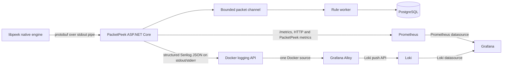

# PacketPeek Monitoring Guide

This guide describes the local Prometheus, Grafana, Loki, and Grafana Alloy stack that runs with PacketPeek through the existing root `docker-compose.yml`. The services are intended for local development. Their published host ports bind to `127.0.0.1`; Prometheus, Loki, and Grafana have no public listener.

## Architecture and data flow



The application exposes its metrics over HTTP. Prometheus scrapes the application and itself. Separately, Alloy discovers eligible Compose containers through the Docker Engine API, reads their stdout/stderr, parses fields from compact Serilog JSON without replacing the original log line, and pushes entries to Loki. Grafana queries Prometheus for metrics and Loki for logs. It does not collect logs itself.

## Components and responsibilities

| Component | Responsibility | Container address / data |
| --- | --- | --- |
| PacketPeek app | ASP.NET Core API and UI; exports `/metrics`; emits compact Serilog JSON to stdout/stderr | `app:8080`; Docker label `observability=true` |
| Prometheus | Scrapes app metrics and its own endpoint; evaluates alert rules | `prometheus:9090`; named volume `prometheus_data`; 15-day retention by default |
| Grafana | Displays provisioned dashboards and queries both data sources | `grafana:3000`; named volume `grafana_data` |
| Loki | Accepts, indexes, stores, and serves logs | `loki:3100`; named volume `loki_data`; 7-day retention |
| Grafana Alloy | Discovers marked containers and sends their Docker logs to Loki | `alloy`; state volume `alloy_data`; local component UI on port `12345` |
| PostgreSQL | PacketPeek application persistence; not part of the metrics/log storage backend | `postgres:5432`; named volume `postgres_data` |

The Compose images are pinned: Prometheus `v3.13.3`, Grafana `13.3.0`, Loki `3.7.0`, and Alloy `v1.21.3`. Loki and Alloy use small local image builds that add a static HTTP readiness probe because their upstream images are distroless.

## Configuration locations

- Prometheus scrape and evaluation configuration: [`prometheus/prometheus.yml`](prometheus/prometheus.yml)
- Prometheus alert rules: [`prometheus/alerts.yml`](prometheus/alerts.yml)
- Loki storage and retention: [`loki/config.yml`](loki/config.yml)
- Alloy Docker discovery, JSON parsing, and Loki output: [`alloy/config.alloy`](alloy/config.alloy)
- Grafana data sources: [`grafana/provisioning/datasources/datasources.yml`](grafana/provisioning/datasources/datasources.yml)
- Grafana dashboard provider: [`grafana/provisioning/dashboards/dashboards.yml`](grafana/provisioning/dashboards/dashboards.yml)
- Provisioned dashboards: [`grafana/dashboards/`](grafana/dashboards/)

Prometheus uses a 15-second scrape interval, a 15-second rule evaluation interval, and a 10-second scrape timeout. The application target is `app:8080` on the Compose network with `metrics_path: /metrics`. Prometheus itself is scraped at `localhost:9090` from inside its own container; there, `localhost` correctly refers to Prometheus.

Prometheus retains 15 days by default. Change `PROMETHEUS_RETENTION` to a Prometheus duration such as `30d` to adjust it. Loki retains `168h` (7 days) in its local filesystem-backed TSDB. The Docker `json-file` log driver rotates each container's local log files at 10 MB with 3 files; Alloy reads those Docker logs through the Docker API.

## Metrics

The app exposes `/metrics` anonymously for Prometheus. PacketPeek metrics use fixed names without IP addresses, flow IDs, request IDs, exception messages, or other user-controlled labels.

| Metric | Type | Meaning |
| --- | --- | --- |
| `packetpeek_engine_packets_received_total` | Counter | Packet events from the native engine successfully accepted by the managed channel. |
| `packetpeek_packets_processed_total` | Counter | Packets evaluated by the managed rule worker. |
| `packetpeek_flows_created_total` | Counter | Flow summaries received from the native engine. |
| `packetpeek_flows_persisted_total` | Counter | Flow summaries persisted to PostgreSQL. |
| `packetpeek_alerts_triggered_total` | Counter | Alerts triggered by rule evaluation. |
| `packetpeek_rule_evaluations_total` | Counter | Individual active rules evaluated. |
| `packetpeek_rule_evaluation_duration_seconds` | Histogram | Time to evaluate the active rules for one packet; histogram buckets support quantiles. |
| `packetpeek_engine_running` | Gauge | `1` while the native engine process runs; otherwise `0`. |
| `packetpeek_engine_capture_expected` | Gauge | `1` only for enabled live-interface capture expected to remain running. Disabled capture and finite PCAP replay report `0`. |
| `packetpeek_engine_errors_total` | Counter | Unexpected native engine failures observed by the application. |
| `packetpeek_channel_depth` | Gauge | Current number of buffered events in the managed bounded channel. |
| `packetpeek_channel_capacity` | Gauge | Configured bounded-channel capacity. |
| `packetpeek_channel_utilization_ratio` | Gauge | Buffered channel depth divided by capacity, clamped to `0`–`1`. This is managed backpressure, not a kernel/libpcap drop count. |
| `packetpeek_active_rules` | Gauge | Number of active rules loaded for the most recent packet evaluation. |
| `packetpeek_db_operation_duration_seconds` | Histogram | Duration of instrumented rule-load queries and flow/alert persistence operations. It does not represent every database call in the application. |
| `packetpeek_db_operation_failures_total` | Counter | Failures from those instrumented database operations. |
| `http_requests_received_total` | Counter | HTTP requests, labeled by bounded method and response code. |
| `http_request_duration_seconds` | Histogram | HTTP request duration from prometheus-net middleware. |
| `http_requests_in_progress` | Gauge | HTTP requests currently being handled. |

The engine does not currently expose a reliable native kernel/libpcap packet-drop counter. Do not interpret channel utilization or `packetpeek_engine_packets_received_total` as native drops. The bounded channel uses wait backpressure when full.

## Grafana data sources and dashboards

Grafana automatically provisions both data sources; no manual import is needed:

- **Prometheus** (`uid: prometheus`) at `http://prometheus:9090`, the default data source.
- **Loki** (`uid: loki`) at `http://loki:3100`.

The file provider loads JSON dashboards from `/var/lib/grafana/dashboards` into the **PacketPeek** folder:

1. **PacketPeek / System Overview** — packet throughput and volume, flow and alert rates, engine status/errors, channel depth/capacity/utilization, rule latency, HTTP request and 5xx rates, and database latency.
2. **PacketPeek / Processing and Engine Health** — engine status/failures, packet and flow throughput, channel depth/capacity/utilization, rule evaluation count and p50/p95/p99 latency, alert rate, and a note that reliable native drop metrics are unavailable.
3. **PacketPeek / Application Logs** — live app logs, error/warning/fatal views, native engine failures, database errors, rule evaluation failures, and startup/shutdown events.

Dashboards use a six-hour default range except the logs dashboard, which uses one hour and refreshes every five seconds. Prometheus panels use five-minute rates for counters and histogram quantiles for latency.

## Alert rules

Prometheus evaluates rules every 15 seconds from `monitoring/prometheus/alerts.yml`:

| Alert | Condition and pending duration | Meaning |
| --- | --- | --- |
| `PrometheusTargetUnavailable` | `up{job="prometheus"} == 0` for 2m | Prometheus cannot scrape its own endpoint. It can only be evaluated while Prometheus is still running. |
| `PacketPeekApplicationUnavailable` | `up{job="packetpeek"} == 0` for 1m | PacketPeek `/metrics` is unavailable to Prometheus. |
| `PacketPeekLiveCaptureStopped` | `packetpeek_engine_capture_expected == 1` and `packetpeek_engine_running == 0` for 1m | Expected continuous live capture is stopped. `packetpeek_engine_capture_expected` is set only when `Engine:Enabled=true`, `Engine:Interface` is nonempty, and `Engine:Pcap` is empty. Disabled capture and finite PCAP replay do not trigger it. |
| `PacketPeekChannelUtilizationHigh` | `packetpeek_channel_utilization_ratio > 0.80` for 5m | Managed channel pressure remains above 80% of configured capacity. This is not a native capture-drop alert. |
| `PacketPeekHTTP5xxRateHigh` | For 5m, 5xx rate `> 0.1/s`, 5xx share `> 5%`, and total request rate `> 1/s` | Elevated server errors with a traffic floor to reduce low-volume noise. |
| `PacketPeekRuleEvaluationLatencyHigh` | p95 of `packetpeek_rule_evaluation_duration_seconds` `> 0.1s` for 5m | Rule evaluation latency is above 100 ms at the 95th percentile. |
| `PacketPeekNativeEngineFailuresRepeated` | `increase(packetpeek_engine_errors_total[15m]) >= 3`, pending 1m | Repeated unexpected native engine failures. Prometheus must scrape the counter before the application exits; the application-unavailable alert covers a stopped app. |

No Alertmanager or notification receiver is configured. Prometheus can display rule state, but this stack does not deliver notifications. The self-scrape rule also cannot report a fully stopped Prometheus process without an external monitoring service.

## Start and stop the stack

Docker Compose requires `POSTGRES_PASSWORD`, `JWT_KEY` (at least 32 bytes), `OPERATOR_PASSWORD`, and `GRAFANA_ADMIN_PASSWORD`. Keep local values in an ignored `.env` file or export them in the shell. The root README's **Run locally** section shows a local credential-generation example. Do not commit real credentials.

Start the complete application and monitoring stack from the repository root:

```sh
docker compose up --build -d
docker compose ps
```

Stop all services and remove their containers/network while preserving named volumes:

```sh
docker compose down
```

To stop only monitoring while leaving PacketPeek and PostgreSQL running:

```sh
docker compose stop prometheus grafana loki alloy
```

Start those existing monitoring containers again with `docker compose start prometheus grafana loki alloy`. To stop log collection only, stop Alloy with `docker compose stop alloy`; PacketPeek continues writing stdout/stderr and Prometheus scraping is unaffected.

`docker compose down --volumes` deletes the named volumes and their stored metrics, logs, dashboards database, and PostgreSQL data. Use it only when intentionally deleting local data.

## Local URLs and ports

| Service | URL | Use |
| --- | --- | --- |
| PacketPeek | [http://localhost:8080](http://localhost:8080) | App UI/API |
| PacketPeek metrics | [http://localhost:8080/metrics](http://localhost:8080/metrics) | Prometheus scrape endpoint |
| Prometheus | [http://localhost:9090](http://localhost:9090) | PromQL graph and query UI |
| Prometheus targets | [http://localhost:9090/targets](http://localhost:9090/targets) | Scrape health and errors |
| Prometheus rules | [http://localhost:9090/rules](http://localhost:9090/rules) | Loaded alert rules and state |
| Grafana | [http://localhost:3000](http://localhost:3000) | Dashboards and Explore |
| Loki | [http://localhost:3100](http://localhost:3100) | Local Loki API/readiness |
| Alloy UI | [http://localhost:12345/graph](http://localhost:12345/graph) | Component graph and health |

The local Grafana username defaults to `admin` (`GRAFANA_ADMIN_USER` can override it). The password comes from `GRAFANA_ADMIN_PASSWORD` in the local environment or ignored `.env` file. Prometheus and Loki have no authentication configured because their published ports bind only to localhost. The Alloy UI and Loki should also remain local.

Within Compose, use service names rather than host URLs: Prometheus scrapes `app:8080/metrics`; Grafana contacts `prometheus:9090` and `loki:3100`; Alloy pushes to `http://loki:3100/loki/api/v1/push`. Loki's gRPC port `9096` and Alloy's Docker socket connection are not published as host ports.

## Query Prometheus

In the Prometheus UI, open **Graph** and enter a PromQL expression. Useful examples:

```promql
up{job="packetpeek"}
rate(packetpeek_packets_processed_total[5m])
rate(packetpeek_flows_created_total[5m])
packetpeek_channel_utilization_ratio
packetpeek_engine_capture_expected
histogram_quantile(0.95, sum by (le) (rate(packetpeek_rule_evaluation_duration_seconds_bucket[5m])))
sum(rate(http_requests_received_total{code=~"5.."}[5m]))
ALERTS{alertstate="firing"}
```

Query the HTTP API from Bash:

```sh
curl -G 'http://localhost:9090/api/v1/query' \
  --data-urlencode 'query=up{job="packetpeek"}'
```

The response is JSON. `up=1` means the latest scrape succeeded; `up=0` means it failed.

## Query Loki

Use Grafana **Explore**, select the Loki data source, and enter LogQL. The main app selector is:

```logql
{application="packetpeek",service="app"}
{application="packetpeek",service="app",level="Error"}
{application="packetpeek",service="app",level="Warning"}
{application="packetpeek",service="app",level="Fatal"}
{application="packetpeek",service="app"} |~ "(?i)(libpeek|native engine|capture engine)"
```

For a direct range query in Bash, Loki accepts Unix seconds for `start` and `end`:

```sh
end=$(date +%s)
start=$((end - 300))
curl -G 'http://localhost:3100/loki/api/v1/query_range' \
  --data-urlencode 'query={application="packetpeek",service="app"}' \
  --data-urlencode "start=$start" \
  --data-urlencode "end=$end" \
  --data-urlencode 'limit=50'
```

The original Serilog compact JSON remains the log line. Alloy uses `@t` for the entry timestamp, maps `@l` to the bounded `level` label when present, and extracts `@mt` and `@x` as structured metadata. It does not turn message text, exception text, request IDs, or packet data into indexed labels. Docker source metadata may also include bounded labels such as `service_name` and `detected_level`.

## Troubleshooting

### PacketPeek is missing from Prometheus

1. Check container states with `docker compose ps` and app output with `docker compose logs --tail=100 app prometheus`.
2. From the host, open `http://localhost:8080/metrics` and confirm it responds.
3. In Prometheus, check [Targets](http://localhost:9090/targets) and query `up{job="packetpeek"}`.
4. The configured target is `app:8080` on the Compose network. Do not change it to `localhost:8080`; inside Prometheus, localhost is the Prometheus container itself.
5. Validate mounted files with `docker compose exec prometheus promtool check config /etc/prometheus/prometheus.yml` and `docker compose exec prometheus promtool check rules /etc/prometheus/alerts.yml`.

After editing Prometheus configuration or rules, reload with `curl -fsS -X POST http://localhost:9090/-/reload` or recreate Prometheus with `docker compose up -d --force-recreate prometheus`. Check `/rules` to confirm rules loaded.

### PacketPeek logs are missing from Loki

1. Check that Loki and Alloy report healthy in `docker compose ps loki alloy`.
2. Inspect `docker compose logs --tail=100 alloy loki` for Docker socket, parsing, or push errors.
3. Open the Alloy [component graph](http://localhost:12345/graph) and confirm Docker discovery targets and the `loki.source.docker` component are healthy.
4. PacketPeek must have the Compose label `observability=true`. Alloy discovers only containers with that label; Loki and Alloy deliberately lack it to prevent loops.
5. Confirm Loki readiness at `http://localhost:3100/ready`, then query `{application="packetpeek",service="app"}` in Grafana Explore.
6. Docker logs come from stdout/stderr via the Docker API. There is no second file-tail source, so the same app event is not collected from both a file and Docker.

Docker's local JSON log rotation retains only the configured 10 MB × 3 files per container. Logs older than those rotated files may no longer be available to Alloy after a collector outage, even while Loki retains already-ingested logs for 7 days.

### Alerts are not firing or notifications are expected

Check [Prometheus Rules](http://localhost:9090/rules), the alert's `for` duration, and the required traffic/sample volume. `PacketPeekLiveCaptureStopped` requires `packetpeek_engine_capture_expected == 1`; the standard disabled configuration and finite PCAP replay intentionally leave it at `0`. This stack has no Alertmanager/receiver, so no notifications are sent.

## Verify persistent storage

Compose stores service data in named volumes:

- `prometheus_data` mounted at `/prometheus` (time series and WAL)
- `loki_data` mounted at `/loki` (chunks, indexes, and compactor data)
- `grafana_data` mounted at `/var/lib/grafana` (Grafana database and state)
- `alloy_data` mounted at `/var/lib/alloy/data` (Alloy component state)
- `postgres_data` mounted at PostgreSQL's data directory

List the current project volumes and inspect one by its actual Compose-prefixed name:

```sh
docker volume ls --filter name=prometheus_data
docker volume inspect packetpeek_prometheus_data
```

The default project prefix is `packetpeek`; if `docker volume ls` shows another prefix, use that exact name with `docker volume inspect`. Stop the stack with `docker compose down`, then start it again and confirm prior Prometheus data/logs remain queryable. A normal `docker compose down` does not remove volumes. Only `docker compose down --volumes` deletes them.

## Disable monitoring

To leave the app and database running but stop all monitoring containers:

```sh
docker compose stop prometheus grafana loki alloy
```

To disable log collection but keep metrics and dashboards, stop only Alloy:

```sh
docker compose stop alloy
```

PacketPeek's `/metrics` endpoint remains available if Prometheus is stopped. The app's Docker stdout/stderr logging also continues if Alloy is stopped. These commands preserve all named volumes and can be reversed with `docker compose start ...`.
